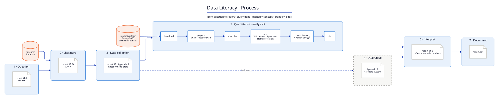

# Data Literacy · From Question to Report

A small research project that applies the methods of the courses **Data Literacy 1 & 2** (Stuttgart Media University) to one question:

> **Do platform and security roles rate AI tools more critically than software developers?**

**Answer:** Hardly. Among people who use AI, platform and security roles rate it only negligibly worse (r<sub>rb</sub> = .05), and the gap in perceived usefulness does not survive correction for multiple tests. The clearer difference lies earlier: platform and security roles more often **do not use AI at all** (19.2% vs. 14.6%). Since non-users barely answered the evaluation questions, the survey cannot show how critical they are.

**→ [Read the report (PDF, 8 pages)](report.pdf)**



## Files

| File | What it is |
|---|---|
| [`report.pdf`](report.pdf) | The research report: question, method, results, discussion |
| [`analysis.R`](analysis.R) | The entire analysis in one base-R script: download → prepare → describe → test → robustness → plot |
| [`docs/report.qmd`](docs/report.qmd) | Source of the report (text + inline numbers from the analysis) |
| [`docs/process.d2`](docs/process.d2) | The diagram above, as code ([D2](https://d2lang.com)) |

## Run it

```bash
Rscript analysis.R                               # results in the console (~2 s, downloads 120 MB data on first run)
quarto render docs/report.qmd --output-dir ..    # builds report.pdf
d2 docs/process.d2 docs/process.svg              # rebuilds the diagram
```

Requires R ≥ 4.3 (no packages), Quarto ≥ 1.4, D2 ≥ 0.6. The data is pinned to a fixed version and verified by checksum.

## Notes

- **Data:** [Stack Overflow Developer Survey 2026](https://survey.stackoverflow.co/), 30,903 responses, ODbL 1.0. Not stored in the repository.
- **Step 4 (qualitative)** is a concept only (report, Appendix B): the data set has no free-text answers, and no interviews were invented.
- **AI assistance:** This project was created with the help of an AI assistant (Claude).
- **License:** code MIT, data ODbL 1.0.
